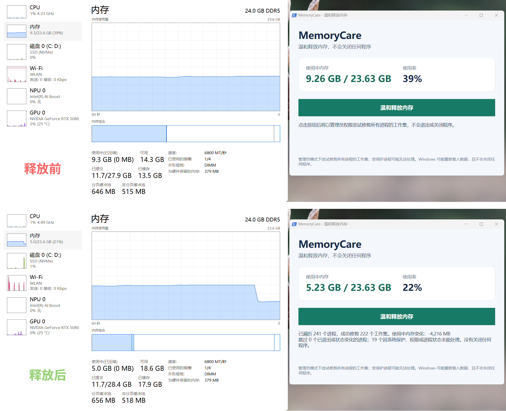

# MemoryCare

一个无需安装的 Windows 11 桌面小工具，用于温和地请求 Windows 回收部分进程工作集。

## 运行

双击 `Start-MemoryCare.cmd`。也可以在 PowerShell 中运行：

```powershell
.\Start-MemoryCare.ps1
```

启动时会请求管理员权限，以便尝试处理不同用户会话中的进程；无需安装额外依赖。

 


## 安全范围

- 不会结束、关闭或重启任何程序。
- 显示的“使用中内存”为物理内存总量减去 Windows 报告的可用物理内存，与任务管理器的“使用中”统计口径相近。
- 尝试处理所有会话的进程工作集，不按大小筛选；系统保护或权限限制仍可能导致部分进程无法处理。
- 不清空待机内存列表，也不修改系统服务或注册表。
- 工作集被修剪后，Windows 或应用可能需要重新载入数据，短时间内可能增加磁盘读取或造成卡顿；内存数字变化不等同于性能提升。
